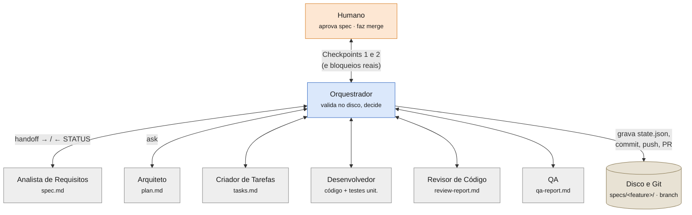
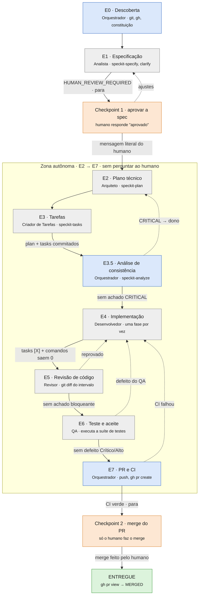

# Fábrica de Software Agêntica Semi-autônoma

*Material de aula · agentes opencode + GitHub Spec Kit*

Um orquestrador conduz uma feature da ideia ao pull request, acionando seis subagentes especializados, um de cada vez. O humano só entra em dois pontos: aprovar a especificação e fazer o merge.

## Quem participa

O orquestrador é o único dono do fluxo. Ele monta o handoff (a passagem de bastão: a mensagem com tudo o que o subagente precisa saber para executar a sua etapa, já que ele começa sem nenhum contexto), troca para a branch da feature, aciona um subagente e espera o bloco de status. Os subagentes nunca chamam uns aos outros e nunca fazem commit.



Todas as setas passam pelo orquestrador: ele envia o handoff e recebe de volta o bloco `STATUS`. A chamada ao Arquiteto está marcada como `ask`, então o ambiente pede confirmação ao humano antes dela (segunda barreira do Checkpoint 1).

## O fluxo de E0 a E8

Cada etapa só avança quando o orquestrador confirma o critério de avanço no disco: o arquivo existe, os testes rodaram e saíram com código 0. O relato do subagente não basta. As setas tracejadas são devoluções: o trabalho volta para quem pode corrigi-lo (máximo de 2 por etapa).



Artefatos de cada etapa:

| Etapa | Artefatos |
|---|---|
| E0 · Descoberta | `constitution.md` · `state.json` |
| E1 · Especificação | `spec.md` · `checklists/` |
| Checkpoint 1 | `specification_review` |
| E2 · Plano técnico | `plan.md` · `research.md` · `quickstart` · `data-model` |
| E3 · Tarefas | `tasks.md` |
| E3.5 · Análise de consistência | relatório (só leitura) |
| E4 · Implementação | código · testes · `[X]` |
| E5 · Revisão de código | `review-report.md` |
| E6 · Teste e aceite | `qa-report.md` |
| E7 · PR e CI | PR · checks da CI |
| Checkpoint 2 | `merge_approval` |
| ENTREGUE | `stage: ENTREGUE` |

> **Ponto central para a aula:** todas as correções técnicas voltam ao Desenvolvedor (E4) e depois passam de novo por Revisor e QA. Mudança de requisito volta ao Checkpoint 1. Há limite de 2 devoluções por etapa e de 5 rodadas de correção por feature; ao estourar, o fluxo vira `BLOCKED` e chama o humano.

## Os dois checkpoints humanos

### Checkpoint 1 · fim de E1 — O que vai ser construído

O orquestrador apresenta a `spec.md` e encerra o turno. Commit não é aprovação. Antes de acionar o Arquiteto, ele precisa citar o trecho literal da mensagem do humano: `Checkpoint 1 aprovado pelo humano: "..."`. Se o humano aprovar mas pedir para não seguir, a aprovação é gravada, o estado fica `ESPECIFICACAO_APROVADA` e o fluxo para; basta pedir para continuar depois.

### Checkpoint 2 · fim de E7 — O que entra na branch base

Com a CI verde, o estado fica `AGUARDANDO_MERGE`. Merge, auto-merge, force push e deploy são proibidos à fábrica. Ao retomar, o orquestrador consulta `gh pr view` para saber se houve merge.

## Regras que fazem a fábrica funcionar

- **Verificar no disco.** "Concluí" sem arquivo e sem comando executado é etapa não concluída. O orquestrador compara o campo `ARTEFATOS` com o que existe de fato.
- **Um subagente por vez.** O próximo só é chamado depois de validar o anterior. Subagentes nunca acionam outros subagentes.
- **Uma branch por spec.** Antes de cada acionamento o orquestrador roda `git switch <branch>` e confere com `git branch --show-current`. Trabalho na branch base reprova a etapa.
- **Spec Kit é a fonte de verdade.** Artefatos das skills `speckit-*` nunca são apagados, renomeados ou mesclados. A `spec.md` só muda via `speckit-clarify`.
- **Estado retomável.** `state.json` guarda etapa, contadores de devolução, comandos de verificação e checkpoints. Uma nova sessão retoma da primeira etapa pendente.
- **Raiz limpa.** Anotações de controle vão para `specs/<feature>/notes/`. Arquivos como `SUMMARY.md` na raiz reprovam a etapa.

## Ciclo de vida no state.json

O campo `stage` percorre esta sequência. Os estados marcados com ⏸ são paradas para o humano (`ESPECIFICACAO_APROVADA` só ocorre quando ele aprova a spec e pede para não seguir).

`NOVA` → `ESPECIFICANDO` → ⏸ `AGUARDANDO_REVISAO_HUMANA` → ⏸ `ESPECIFICACAO_APROVADA` → `PLANEJANDO` → `CRIANDO_TAREFAS` → `ANALISANDO` → `IMPLEMENTANDO` → `REVISANDO` → `TESTANDO` → `PUBLICANDO_PR` → ⏸ `AGUARDANDO_MERGE` → `ENTREGUE`

`BLOCKED` e `CANCELADA` podem ocorrer em qualquer ponto.

## O contrato entre orquestrador e subagente

Todo handoff (a mensagem de acionamento do subagente, como uma passagem de plantão) leva 10 itens: feature e branch, etapa e skill, artefatos de entrada, decisões já ratificadas, pendências a apenas registrar, limite de escopo, local das anotações, comandos de verificação, escopo específico (fase ou apontamentos) e formato de retorno. O retorno é sempre este bloco:

```text
STATUS: DONE | BLOCKED | NEEDS_CLARIFICATION | HUMAN_REVIEW_REQUIRED
PARECER: aprovado | aprovado com ressalvas | reprovado   (Revisor e QA)
ARTEFATOS: caminhos criados/alterados, um por linha
TESTES: comando executado e código de saída
BLOQUEIOS: itens, ou "nenhum"
PRÓXIMO: etapa sugerida, ou "nenhum"
```

`aprovado com ressalvas` conta como aprovação; as ressalvas vão para a descrição do PR. Dúvida técnica o subagente decide sozinho e registra como premissa. Dúvida de requisito volta ao humano.

## Anatomia de um arquivo de agente

Cada agente é um arquivo `.md` com duas partes. No topo, entre as linhas `---`, fica o cabeçalho (frontmatter), escrito em YAML: são as configurações que o opencode lê para saber como rodar o agente. Abaixo do cabeçalho vem o corpo, em Markdown, que é o prompt de sistema: as instruções que o modelo recebe sobre o seu papel. O nome do agente vem do nome do arquivo. Como os arquivos estão na pasta `fabrica-software/`, o orquestrador chama o Arquiteto de `fabrica-software/subagent-arquiteto`.

Este é o cabeçalho real do orquestrador, comentado:

```yaml
---
description: Agente orquestrador do fluxo Fábrica de Software
mode: primary                            # agente principal, conversa com o humano
steps: 150                                # máximo de iterações por sessão
model: 9router-ajudamente/ajudamente-texto # provedor/modelo
temperature: 0.1                          # quase determinístico: segue regras
permission:
  task:                                    # quais subagentes pode acionar
    "*": deny                                # 1. nenhum, por padrão
    "fabrica-software/subagent-*": allow     # 2. os seis da fábrica, sim
    "fabrica-software/subagent-arquiteto": ask  # 3. o Arquiteto pede confirmação
  edit:                                    # quais arquivos pode alterar
    "*": deny
    "specs/*/state.json": allow
    "specs/*/notes/**": allow
  bash:                                    # quais comandos de terminal pode rodar
    "*": allow
    "git push --force*": deny
    "git rebase*": deny
    "gh pr merge*": deny
    # ...
---

Você é o orquestrador da Fábrica de Software...  # corpo = prompt de sistema
```

| Campo | O que significa | Nesta fábrica |
|---|---|---|
| `description` | Diz o que o agente faz e quando usá-lo. É obrigatório. O modelo lê esse texto para decidir qual subagente chamar. | Uma frase por papel |
| `mode` | `primary` é um agente que conversa com o usuário; `subagent` só é acionado por outro agente; `all` (padrão) serve aos dois usos. | Orquestrador `primary`; os seis, `subagent` |
| `model` | Modelo usado, no formato `provedor/modelo`. Se um subagente não define, ele usa o modelo do agente que o acionou. | Só o orquestrador define |
| `temperature` | Grau de variação das respostas, de 0 a 1. Valores baixos deixam o agente mais previsível; valores altos, mais criativo. | `0.1` no orquestrador |
| `steps` | Número máximo de iterações (chamadas de ferramenta) antes de o agente ter que parar e responder. Sem o campo, não há limite. | `150` no orquestrador |
| `permission` | Regras do que o agente pode fazer, por ferramenta. Cada regra vale `allow` (faz sem perguntar), `ask` (pede confirmação ao humano) ou `deny` (bloqueado). | Em todos os agentes |
| `permission.task` | Quais subagentes este agente pode acionar, pelo nome. | Só no orquestrador |
| `permission.edit` | Quais arquivos pode criar ou alterar, por caminho. | Restrito em quase todos |
| `permission.bash` | Quais comandos de terminal pode executar. | Liberado, com git e gh bloqueados |

### Como as regras de permissão são lidas

Os padrões usam curinga: `*` casa com qualquer sequência de caracteres. Quando vários padrões casam com o mesmo pedido, **vale o último da lista**. A ordem importa mais que a especificidade. Por isso a regra geral `"*"` vem primeiro e as exceções depois. Veja o bloco `task` do orquestrador:

| O orquestrador tenta acionar | Regras que casam | Resultado |
|---|---|---|
| `fabrica-software/subagent-qa` | 1 (deny), 2 (allow) | **allow**: aciona direto |
| `fabrica-software/subagent-arquiteto` | 1 (deny), 2 (allow), 3 (ask) | **ask**: o humano confirma antes |
| `outro-agente` | 1 (deny) | **deny**: bloqueado |

No `bash` é o contrário: tudo liberado e exceções bloqueadas. `git push --force origin main` casa com `"*": allow` e depois com `"git push --force*": deny`; vale o último, então é bloqueado. Se a regra `"*": allow` estivesse no fim da lista, ela liberaria tudo, inclusive o force push.

### O que muda no cabeçalho dos subagentes

Os seis subagentes seguem o mesmo padrão, com três diferenças em relação ao orquestrador: `mode: subagent`, nenhum `model` (herdam o do orquestrador) e um `bash` que bloqueia `git commit`, `git push`, `git merge`, criação de branch e qualquer comando `gh`. O `edit` varia conforme o papel: o Revisor só escreve o `review-report.md` e as notas, e o Criador de Tarefas só o `tasks.md` e as notas. O Desenvolvedor e o QA não têm regra de `edit`, então podem editar qualquer arquivo; o limite do QA (só testes e `qa-report.md`) está apenas no prompt. Isso é bom para discutir em aula: uma regra no prompt depende do modelo obedecer, e uma regra no cabeçalho é aplicada pela ferramenta.

## Permissões de cada papel

As permissões no frontmatter de cada agente reforçam as regras escritas no prompt. Nenhum subagente pode fazer commit, push, merge, criar branch ou usar o `gh`.

| Papel | Pode editar | Git e GitHub |
|---|---|---|
| **Orquestrador** | `state.json`, `notes/**` | commit, push, `gh pr create`; bloqueados: merge, force push, rebase, reset --hard |
| Analista | `specs/**` | sem commit, push ou gh |
| Arquiteto | `specs/**`, `AGENTS.md` | sem commit, push ou gh; acionamento exige confirmação (`ask`) |
| Criador de Tarefas | `tasks.md`, `notes/**` | sem commit, push ou gh |
| Desenvolvedor | código e testes unitários | sem commit, push ou gh |
| Revisor | `review-report.md`, `notes/**` | sem commit, push ou gh |
| QA | testes de aceite e `qa-report.md` (regra do prompt) | sem commit, push ou gh |

## Um modelo diferente para cada papel

Separar papéis só protege a entrega se quem verifica pensa de forma diferente de quem produziu. Quando o mesmo modelo escreve o código, revisa o código e testa a entrega, os erros ficam correlacionados: o que ele não enxergou ao implementar, tende a não enxergar ao revisar.

- **Pontos cegos compartilhados.** Se o Desenvolvedor entendeu errado um requisito, um QA com o mesmo modelo tende a ler a spec do mesmo jeito. Ele escreve testes que confirmam o erro, e a suíte passa com um falso positivo.
- **Preferência pelo próprio estilo.** Modelos costumam avaliar melhor textos e códigos parecidos com os que eles mesmos gerariam. Um Revisor do mesmo modelo aprova com mais facilidade soluções "do seu jeito", mesmo quando há opção mais simples ou segura.
- **Segregação de funções.** É a mesma lógica de uma equipe humana: quem escreve o PR não aprova o próprio PR. Trocar o modelo é o equivalente a colocar outra pessoa, com outra formação, para revisar.

A diversidade importa mais nos pares em que um papel verifica o trabalho do outro:

| Quem produz | Quem verifica | O que um modelo diferente ajuda a pegar |
|---|---|---|
| Desenvolvedor | Revisor | bugs de lógica, falhas de segurança e atalhos que o autor considerou "óbvios" |
| Desenvolvedor | QA | interpretação errada da spec, casos de borda e entradas inválidas não pensadas |
| Arquiteto | Criador de Tarefas | passos do plano que não fecham ao virar tarefas concretas |
| Analista | Arquiteto | requisitos ambíguos que só aparecem na hora de planejar |

Na prática, no opencode, cada agente aceita o campo `model` no frontmatter. Hoje só o `orquestrador.md` define um modelo; os subagentes não definem, então todos herdam o modelo do orquestrador que os aciona. Ou seja, a fábrica atual usa um único modelo para os seis papéis. Basta acrescentar uma linha em cada arquivo:

```yaml
---
description: Revisor de código da Fábrica de Software ...
mode: subagent
model: <provedor>/<modelo-diferente-do-desenvolvedor>
permission:
  ...
---
```

Uma regra simples para começar: o Revisor e o QA usam modelos diferentes do Desenvolvedor e, se possível, diferentes entre si. Diversidade de modelos reduz a correlação entre os erros, mas não a elimina. Ela complementa a verificação no disco, os testes executados e os checkpoints humanos; não substitui nenhum deles.

## Instalação no opencode

### 1. Prepare o repositório do projeto

A fábrica usa obrigatoriamente o Git para criar branches e o GitHub para abrir pull requests. Por isso, o projeto precisa estar publicado em um repositório no GitHub e clonado na máquina; todo o desenvolvimento acontece nesse clone.

- O repositório precisa ter pelo menos um commit na branch base e o remoto `origin` configurado.
- A CLI `gh` precisa estar autenticada (`gh auth status`).
- No clone, adicione e inicialize as skills do [GitHub Spec Kit](https://github.com/github/spec-kit) (GHSK) para o opencode e rode `/speckit-constitution` para criar as definições do projeto (`constitution.md`).

O orquestrador confere esses pré-requisitos em E0 e para se algum faltar; ele não roda `git init` nem configura remotos por conta própria.

### 2. Copie os agentes

Os agentes ficam na pasta global do opencode. No Windows, crie a pasta `C:\Users\<usuário>\.config\opencode\agents\fabrica-software` e copie para ela os arquivos `.md` da pasta [`src/`](src/) deste repositório. No PowerShell, a partir da raiz deste repositório:

```powershell
$destino = "$env:USERPROFILE\.config\opencode\agents\fabrica-software"
New-Item -ItemType Directory -Force $destino | Out-Null
Copy-Item .\src\*.md $destino
```

A pasta deve ficar assim:

```text
C:\Users\<usuário>\.config\opencode\agents\fabrica-software\
├── orquestrador.md
├── subagent-analista-requisitos.md
├── subagent-arquiteto.md
├── subagent-criador-tarefas.md
├── subagent-desenvolvedor.md
├── subagent-qa.md
└── subagent-revisor-codigo.md
```

O nome da subpasta faz parte do nome do agente. É por isso que o orquestrador aciona `fabrica-software/subagent-arquiteto`, e as permissões de `task` só funcionam se a pasta se chamar exatamente `fabrica-software`.

O `orquestrador.md` define `model: 9router-aula/combo-free`. Troque pelo provedor e modelo que você tem configurado no opencode antes de usar.

### 3. Selecione o orquestrador

Reabra o opencode no clone do projeto e selecione o agente `fabrica-software/orquestrador` (tecla `Tab` alterna entre os agentes primários). Todos os prompts a seguir são enviados com ele selecionado.

## Exemplo de uso

O exemplo usa duas demandas sobre um frontend que exibe a data/hora do servidor. A primeira é obrigatória para o exemplo; a segunda é opcional.

### Primeira demanda: especificar

Primeiro prompt:

```text
@fabrica-software/subagent-analista-requisitos
Nova feature.
No frontend a data/hora do servidor deve aparecer no formato pt-br e em cor vermelha. Não precisa ser atualizada e deve usar a timezone America/Sao_Paulo.
```

O prompt aciona o Analista de Requisitos, que cria a especificação com o GHSK e pode fazer perguntas para esclarecer a demanda. Com o projeto aberto no VS Code, observe que a pasta `specs/` foi criada com a especificação da demanda e que o orquestrador criou a branch da feature.

**Opcional.** A qualquer momento antes da aprovação, envie um prompt para ajustar um requisito (o ajuste passa pelo `speckit-clarify`):

```text
Preciso clarificar um requisito na feature.
A cor vermelha deve ser em tom escuro.
```

Quando o orquestrador pedir a aprovação (Checkpoint 1), aprove, mas peça para não seguir com o Arquiteto. Uma aprovação simples já faz os próximos subagentes começarem a trabalhar.

```text
Aprovo a especificação, mas não siga com o arquiteto.
```

Ao final, a branch da feature tem um commit com a spec aprovada e o `state.json` fica em `ESPECIFICACAO_APROVADA`.

### Segunda demanda: especificar a partir da primeira (opcional)

Numa nova sessão, envie:

```text
@fabrica-software/subagent-analista-requisitos
Nova feature. No frontend, abaixo da data/hora, apresentar bom dia, boa tarde ou boa noite, de acordo com o momento do dia. Criar uma nova branch a partir da atual. É uma nova feature a partir da implementação da branch atual.
```

Aprove a especificação da mesma forma, sem seguir para o Arquiteto.

### Executar o backlog

As especificações aprovadas ficam em `specs/` (por exemplo, `001-servidor-timestamp-pt-br` e `002-saudacao-horario`) e formam o backlog ainda não implementado. Há duas formas de implementá-las.

#### Manual

Envie um prompt por spec, com o orquestrador selecionado:

```text
@fabrica-software/subagent-arquiteto implemente a spec 001-servidor-timestamp-pt-br.
```

Espere a primeira spec terminar antes de pedir a segunda, já que a `002` parte da implementação da `001`.

#### Agendada

Instale no opencode o plugin `opencode-scheduler-v2`, adicionando-o ao arquivo de configuração (`opencode.json`):

```json
{
  "plugin": [
    "opencode-scheduler-v2"
  ]
}
```

Reabra o opencode, confirme que o plugin foi carregado e, com o orquestrador selecionado, envie (troque a data e a hora):

```text
/schedule agendar para DD/MM/AAAA às HH:MM:

Execute as duas especificações abaixo, obrigatoriamente em sequência,
uma de cada vez.

ORDEM DE EXECUÇÃO:

1. @fabrica-software/subagent-arquiteto
   Especificação: 001-servidor-timestamp-pt-br

2. @fabrica-software/subagent-arquiteto
   Especificação: 002-saudacao-horario

REGRAS OBRIGATÓRIAS:
- Quando tarefas sequenciais, atualizar branch da próxima tarefa com os dados da anterior.
- Não execute as duas tarefas em paralelo.
- Inicie a primeira especificação e aguarde sua conclusão integral.
- Aguarde o subagente retornar o resultado final.
- Verifique se a implementação foi concluída com sucesso.
- Somente depois disso, inicie a segunda especificação.
- A segunda execução deve considerar o estado atualizado do projeto
  após a primeira implementação.
- Não inicie a próxima tarefa enquanto a anterior estiver em execução.
- Se a primeira tarefa falhar, interrompa a sequência e não execute a segunda.
- Ao final, apresente um relatório individual de cada especificação.
```

### Resultado final

Cada spec percorre a zona autônoma (E2 a E7): Arquiteto, Criador de Tarefas, Desenvolvedor, Revisor de Código e QA. Ao término, o orquestrador abre um pull request por spec, que fica aguardando a aprovação do responsável (Checkpoint 2). Depois de aprovar e fazer o merge, o deploy automático fica a cargo do GitHub Actions, como visto em aula.

## Roteiro sugerido para a aula

1. **O problema.** Por que um único agente que faz tudo perde o controle em features grandes. *(10 min)*
2. **Os papéis.** Primeiro diagrama: orquestrador no centro, subagentes nas pontas, humano só nos checkpoints. *(15 min)*
3. **O fluxo.** Percorrer E0 a E8 no segundo diagrama, parando em cada critério de avanço. *(25 min)*
4. **As devoluções.** Simular um defeito encontrado pelo QA e seguir a seta de devolução até o PR de novo. *(15 min)*
5. **Controles de segurança.** Checkpoints, permissões, verificação no disco, limites de rodadas e um modelo diferente para cada papel. *(15 min)*
6. **Prática.** Rodar a fábrica numa feature pequena e acompanhar o `state.json` mudando. *(30 min)*

## Perguntas para discussão

- Por que o commit da spec não pode contar como aprovação do Checkpoint 1?
- O que poderia dar errado se o Desenvolvedor pudesse editar os testes criados pelo QA?
- Por que o orquestrador roda os comandos de teste em vez de confiar no relato do subagente?
- Qual o efeito de limitar a 2 devoluções por etapa e 5 rodadas por feature?
- Que tipo de dúvida o subagente resolve sozinho, e que tipo precisa voltar ao humano?
- O que acontece com o bloco `bash` do orquestrador se a linha `"*": allow` for movida para o fim?
- Quais regras da fábrica estão só no prompt e poderiam ir para o cabeçalho?
- Se o Desenvolvedor, o Revisor e o QA usam o mesmo modelo, que tipo de erro tem mais chance de chegar ao PR?
